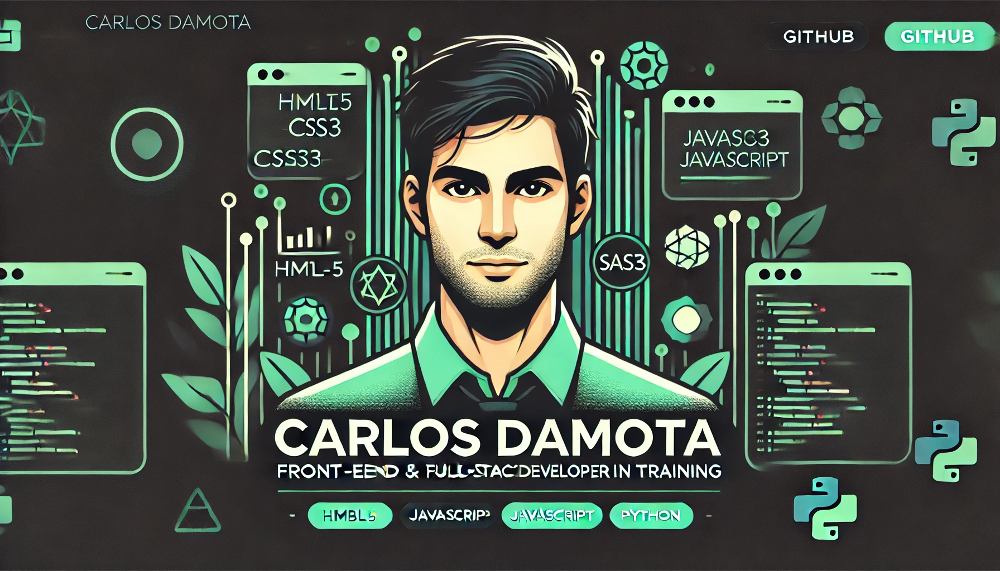

<!-- Imagen de Cabecera -->

  

<h1 align="center">Carlos Damota</h1>

  <strong>Desarrollador Full-Stack</strong> · Productos con IA agéntica · Fundador de Fittwiz y Kidpoints

  
  
  
  
  
  

---

## Sobre mí

Construyo productos web completos: interfaz en **React / Next.js con TypeScript**, backend en **Node**, datos en **Supabase / MongoDB / Firebase**, pagos con **Stripe** y despliegue en **Vercel / Cloud Run**.

Soy fundador de dos productos propios en producción:

- **Fittwiz**: PWA de fitness y nutrición con IA agéntica — rutinas hiper-personalizadas y análisis nutricional por imagen con modelos de lenguaje, pagos recurrentes con Stripe y sincronización con la API de Strava.
- **Kidpoints**: PWA de refuerzo positivo para familias con niños neurodivergentes, con arquitectura serverless en Google Cloud Run y Firebase.

Antes de esto pasé **14 años liderando operaciones de retail y e-commerce** en Cash Converters España (2010–2024): catálogo, pedidos, garantías y RMA, gestión de equipos y almacén. Allí hice también mi primer desarrollo en producción: una herramienta web interna, autogestionada de principio a fin, para tasar componentes informáticos y eliminar los errores de cálculo manual. Esa etapa me dejó criterio de negocio, trato con personas y una obsesión sana por los procesos bien definidos.

Formación continua, sin atajos:

- **Máster en Desarrollo Web Full-Stack** — Nuclio Digital School (2025)
- **Certificado Profesional Nivel 3, IFCD0210** — CEOP Tarragona (2026)
- **Certificado Profesional de Ciberseguridad** — Google Career Certificates (2024)
- **Desarrollo Python Full-Stack** — IBM SkillsBuild (2024)
- **Técnico en Electrónica** — Escola del Treball de Barcelona (2006)

Estoy disponible para **tiempo completo o proyectos freelance**. Me interesan los equipos que cuidan el código, documentan sus decisiones y tratan la accesibilidad y el rendimiento como parte del producto, no como un extra.

---

## Cómo trabajo

Trabajo con agentes de código como parte del proceso, no como sustituto del criterio:

- **Método antes que velocidad:** planificación por tareas reanudables y commits de unidad de trabajo revisables (~400 líneas), con tests y documentación junto al código.
- **TDD cuando aplica:** rojo, verde, refactor. Y verificación independiente cuando el cambio toca datos, seguridad o contratos públicos.
- **Revisión con segunda opinión:** revisión por lentes (riesgo, resiliencia, legibilidad, fiabilidad) antes de dar algo por terminado.
- **Documentación como producto:** lo que aprendo queda escrito y publicable, no solo en mi cabeza.

---

## Proyectos destacados

| Proyecto | Qué resuelve | Stack |
| :--- | :--- | :--- |
| **[Fittwiz](https://fittwiz.app)** | PWA de fitness y nutrición con IA agéntica: rutinas personalizadas, análisis nutricional por imagen, suscripciones y sincronización con Strava. | Next.js · TypeScript · Gemini · Stripe · Tailwind · PWA |
| **Kidpoints** | Gestión conductual y refuerzo positivo para familias con niños neurodivergentes; serverless de alta disponibilidad. | React · TypeScript · Cloud Run · Firebase · Stripe · Resend |
| **[Portafolio y documentación](https://carlosdamota.com)** | Mi sitio personal y base de conocimiento técnico: guías de herramientas, catálogo de skills para agentes y notas de arquitectura. | Next.js 16 · React 19 · TypeScript · Tailwind 4 · daisyUI · Supabase |
| **Elena Art** | E-commerce para artista independiente con back-office de pedidos, encargos y cobros. | Next.js · TypeScript · Supabase · Stripe · Resend |

---

## Documentación técnica

Escribo guías que me habría gustado encontrar cuando empecé con cada herramienta:

- [**Gentle-Shell y Gentle-AI: instalación, ODD y revisión nativa**](https://carlosdamota.com/docs/instalacion-gentle-shell-gentle-ai) — cómo convertir el harness Pi en una estación de trabajo agéntica, con modos de permisos, atajos y flujo de revisión.
- [**Catálogo de skills para agentes**](https://carlosdamota.com/docs/catalogo-skills-agentes) — registro vivo de las skills que uso y cómo encajan entre sí.
- [**OpenDesign: instalación y ciclo de vida**](https://carlosdamota.com/docs/guia-instalacion-ciclo-de-vida-opendesign) — ejecución local, Docker y la colisión del binario `od`.

→ Todas en [carlosdamota.com/docs](https://carlosdamota.com/docs)

---

## 🧰 Stack

  

`html | css | sass | js | ts | react | nextjs | nodejs | express | mongodb | socketio | tailwind | daisyui | supabase | firebase | stripe | googlecloud | docker | git | github | vscode | vercel | netlify | postman | python | warp`

---

## 📊 GitHub Stats

  
  

  

---

  <a href="https://carlosdamota.com"><strong>carlosdamota.com</strong></a> ·
  <a href="https://carlosdamota.com/docs">Documentación</a> ·
  <a href="https://www.linkedin.com/in/carlos-damota/">LinkedIn</a>

